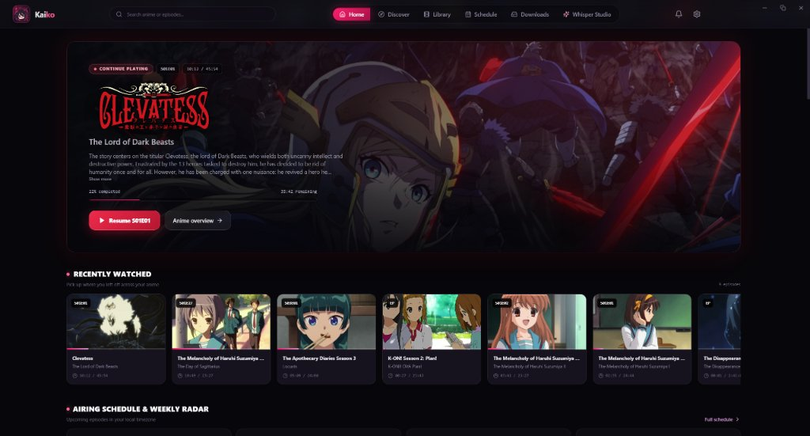
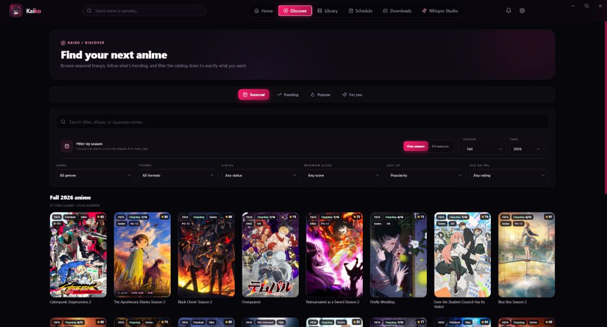
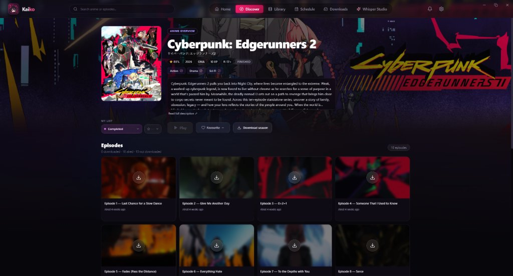
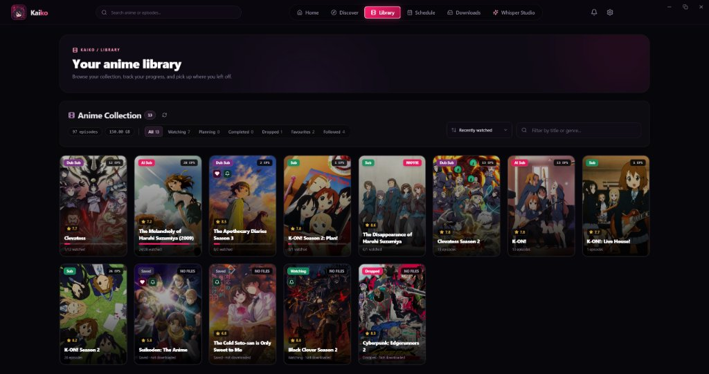
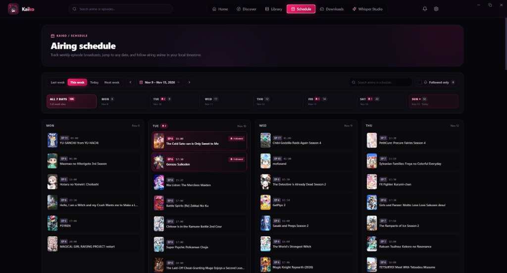
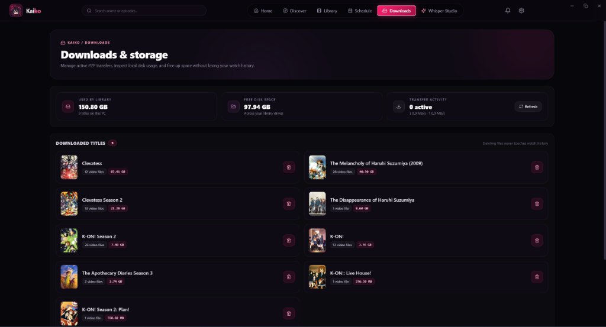
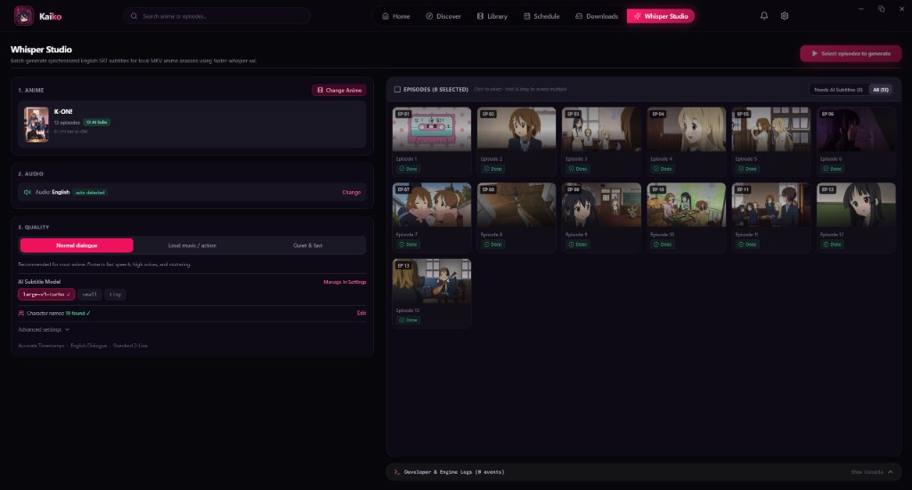
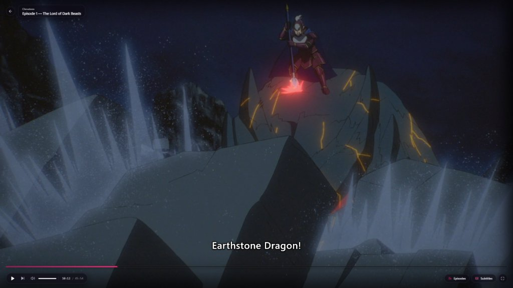

# Kaiko

<p align="center">
  
</p>

<p align="center"><strong>Your anime library, player, and subtitle studio — on your PC.</strong></p>

<p align="center">
  
  
  
  
</p>

Kaiko organizes anime files already on your drives, fetches catalog metadata, and plays episodes locally with built-in FFmpeg support. Optional features include local AI subtitle generation with Faster-Whisper and torrent downloads from RSS/Torznab indexers that you configure yourself.

## Screenshots

<table>
  <tr>
    <td align="center" width="50%">
      
      <br />
      <sub><strong>Home</strong> — Continue watching hero banner, recent episodes rail, and airing radar</sub>
    </td>
    <td align="center" width="50%">
      
      <br />
      <sub><strong>Discover</strong> — Seasonal catalog, trending/popular feeds, and multi-criteria filtering</sub>
    </td>
  </tr>
  <tr>
    <td align="center" width="50%">
      
      <br />
      <sub><strong>Anime Overview</strong> — Clearlogo header, synopsis, watchlist status, and episode list</sub>
    </td>
    <td align="center" width="50%">
      
      <br />
      <sub><strong>Library</strong> — Local collection browser with status filters, badges, and progress tracking</sub>
    </td>
  </tr>
  <tr>
    <td align="center" width="50%">
      
      <br />
      <sub><strong>Airing Schedule</strong> — 7-day board, week/date navigation, live search, and followed filter</sub>
    </td>
    <td align="center" width="50%">
      
      <br />
      <sub><strong>Downloads & Storage</strong> — Disk usage overview, transfer activity, and downloaded titles</sub>
    </td>
  </tr>
  <tr>
    <td align="center" width="50%">
      
      <br />
      <sub><strong>Whisper Studio</strong> — Batch episode selection, dialogue presets, and Faster-Whisper setup</sub>
    </td>
    <td align="center" width="50%">
      
      <br />
      <sub><strong>Video Player</strong> — Local MKV playback with styled subtitles and quick drawers</sub>
    </td>
  </tr>
</table>

## Features

- **Home & catalog navigation:** hero resume banner with official series clearlogos and current-episode synopses, recent playback rail, weekly airing radar, and horizontal rails with full-strip hover arrows, click-and-drag and two-finger touchpad edge wrap-around with a magnetic progress indicator, and `See all` links that open Discover in the selected category or genre.
- **Anime discovery & overview:** seasonal, trending, popular, and personalized ("For you") modes; filter by season/year, genre, format, airing status, minimum score, sort order, and age rating. Detailed series pages show clearlogos, synopsis, franchise relations, watchlist status/score controls, and episode lists with 16:9 stills and air dates.
- **Airing schedule:** switch between a full 7-day board and single-day views, step across weeks (`Last week`, `This week`, `Today`, `Next week`) or jump to any date with the calendar picker, search titles directly inside the schedule, and filter by `Followed only`.
- **Library & playback:** scan multiple local folders, track progress and watch status without full disk rescans on list edits, and play 10-bit HEVC/MKV files with bundled FFmpeg, styled ASS/SRT/Blu-ray PGS subtitles, chapter/intro skip support, and an episode/subtitle drawer.
- **Downloads & storage management:** view library disk usage, free drive space, and active transfer speeds; manage P2P episode/season downloads from user-configured RSS/Torznab indexers; delete local series or episodes to free disk space while keeping watch history intact.
- **Whisper Studio:** batch-generate synchronized English SRT subtitles locally with Faster-Whisper-XXL, automatic English audio track selection, `pyannote_v3` dialogue presets tuned for high/child voices, hallucination/spillover post-processing, optional character name hints, and 1-click in-app engine and model installation.
- **Windows integration:** animated startup splash screen, native `Kaiko.exe` process identity in Windows Task Manager, fast single-pass parallel auto-updates with in-app release notes, and desktop/Start Menu shortcuts.

## Torrent and indexer model

Torrent downloads are an optional feature. The application includes a built-in WebTorrent client; it is **not** a front end for an external qBittorrent or Transmission installation. You provide and configure your own RSS/Torznab indexer endpoints in **Settings -> P2P & Downloads**. No indexer feeds or credentials are shipped in the repository, and the engine will not start until you enable it and accept the in-app notice.

For a magnet link that contains no tracker address, the engine appends a small list of public tracker addresses bundled with the app to improve peer discovery. Magnets that already contain trackers keep their own tracker list. Trackers only help peers find each other; they do not provide search results or host download content. You are responsible for the sources you configure and the material you download or share; check the laws that apply where you live.

## What's new in 3.3.0

- **Automatic Background Signs & Songs:** when no dedicated Signs/Forced track is active and Main Subtitle is not already ASS/SSA (for instance, English Dub with Whisper SRT or no dialogue subs), Kaiko automatically extracts a standalone `.en.signs.ass` track from eligible embedded ASS/SSA tracks or fetches high-confidence online Signs/ASS subtitles in the background — while respecting explicit `OFF` preferences.
- **1-Click Local ASS Extractor & Online Subtitle Search:** extract typeset signs, titles, notes, credits, and OP/ED karaoke cleanly from embedded ASS/SSA tracks (`electron/assSignsExtractor.ts`), or search keyless online via **TsukiHime** (with `.xz` decompression and font attachment downloading for JASSUB) plus optional **SubSource**, **SubDL**, and **OpenSubtitles** keys.
- **MKV Track Probing & Font Matching Fixes:** fixed FFmpeg `Metadata: title` parsing so `(Tsundere) Signs & Songs` tracks are detected properly, added explicit `-f ass` / `-f srt` muxer args for reliable embedded extraction, improved Season 1 vs Season 2 batch matching, and raised obfuscated TTF font matching up to 24 fonts.

## What's new in 3.2.1

- **Blu-ray PGS Bitmap Subtitles (`hdmv_pgs_subtitle`):** added native `.sup` parser and RGBA/PNG decoder (`electron/pgs.ts`) with `/pgs` HTTP serving so both `2ND SUB / SIGNS (TOP)` and `MAIN SUBTITLE (BOTTOM)` render Blu-ray bitmap signs and dialogue tracks accurately.
- **Seek-Window Timestamp & Top-Slot Placement Fixes:** preserved original timestamps (`-copyts`) during 2-minute windowed extraction, added seek-triggered window re-extraction (`seekWindowHandlerRef`) when scrubbing outside cached bounds, centered `2ND SUB / SIGNS (TOP)` PGS bitmaps in the top slot so bottom-authored signs do not collide with main subtitles, and added a clean `PGS` codec badge in the Audio & Subtitle Manager.

## What's new in 3.2.0

- **Whisper Studio & Subtitle Rendering:** switched dialogue presets to `pyannote_v3` VAD to preserve high-pitched and child-voice lines, removed forced synthetic prompt prefixes that caused early-line drops and leaked fragments, restored context conditioning (`condition_on_previous_text`) and comma splitting (`--max_comma_cent 70`), filtered non-Latin gibberish/stutter loops, merged 1-2 word trailing cue spillovers, and widened the player subtitle box (`max-w-[92vw]`) to stop unwanted 3-line wrapping.
- **Movie Labels (`Movie` / `Resume Movie`):** feature films now display `Movie` and `Resume Movie` instead of `EP` / `Resume EP` across the Home hero banner, Recent Episodes rail, player Episode Drawer, Anime Detail view, and Season Hero chips.
- **Centered Completion Notification:** fixed the post-episode completion/delete prompt shifting off-center during Framer Motion animation.
- **Discover Filter Dropdowns:** all single-select filter menus (`Season`, `Year`, `Format`, `Status`, `Minimum score`, `Sort by`, `Age rating`) now close automatically after selection while keeping the multi-select `Genre` picker open.

## Install the Windows app

Download the `Kaiko-Setup-3.3.0.exe` installer from the project’s GitHub Releases page, run it, and choose an install folder. The installer creates Desktop and Start Menu shortcuts. Updates can also be installed directly from within the app via **Settings -> Application Updates** or the startup update prompt (with rendered GitHub release notes). During a normal uninstall, Kaiko asks separately whether to remove saved settings, anime lists, and watch history, and whether to clear the contents of configured media-library folders. Both choices default to **No**; deleting library contents requires a second confirmation listing the folders. Clearing a library folder removes every file inside it, not just Kaiko downloads, and leaves the folder itself in place. Silent uninstall and app upgrades preserve personal data.

FFmpeg and a lightweight 7-Zip decompression engine (`7z.exe` + `7z.dll`) are bundled directly into Kaiko for playback, extraction, and automated setup on Windows 10 and Windows 11. The Faster-Whisper-XXL engine can be downloaded and configured in 1 click directly inside Kaiko (or auto-detected from Subtitle Edit / custom paths), along with AI models (`large-v3-turbo`, `medium`, and `small`).

## Build from source

### Requirements

- Windows 10 or 11, 64-bit
- Node.js 18 or later and npm
- Git
- Optional: .NET Framework C# compiler for the standalone shortcut launcher

### Clean install and development

```powershell
git clone https://github.com/zeystom/anime-media-center.git
cd anime-media-center
npm ci
npm run dev
```

### Build and package

```powershell
npm run build
npm start
npm run package
```

`npm run package` creates the Windows NSIS installer under `dist-build/`. `setup.bat` is a convenience script that builds the app and refreshes the local launcher and shortcuts.

### Tests

```powershell
npm test
npm run test:all
```

`npm test` runs the standard regression suite. `test:all` also runs the additional adversarial and interaction checks.

## Network services and local data

Kaiko contacts third-party services for catalog and episode metadata, image assets, intro skip data, and age-rating updates. Your library paths, playback history, settings, and watchlist are stored locally in the app’s user-data folder. Torrent indexer requests use the feeds you configure; there are no bundled feeds or indexer credentials. Whisper transcription runs locally with Faster-Whisper-XXL.

The bundled age-rating index is derived from the [anime-mapper project](https://github.com/subhajeetch-fl/anime-mapper). Source and refresh details are in [`src/data/AGE-RATINGS-SOURCE.md`](src/data/AGE-RATINGS-SOURCE.md). To refresh the bundled copy during development, run `npm run update:age-ratings`.

## License

Kaiko is released under the [MIT License](LICENSE). Third-party services, tools, datasets, and dependencies remain subject to their own terms and licenses.
