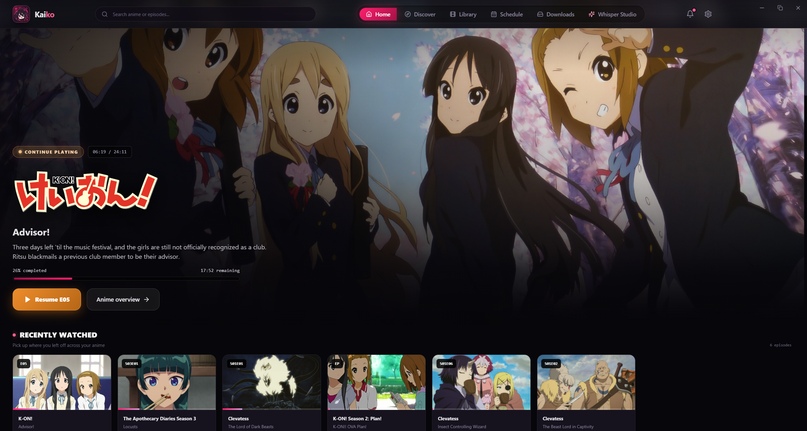
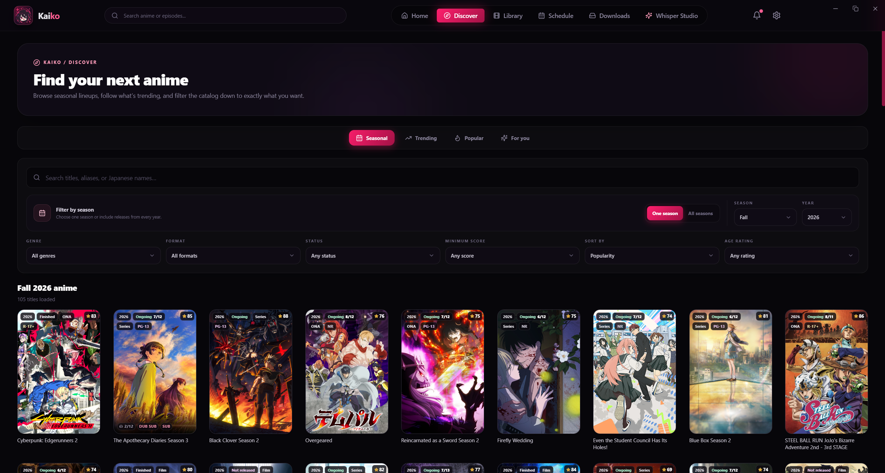
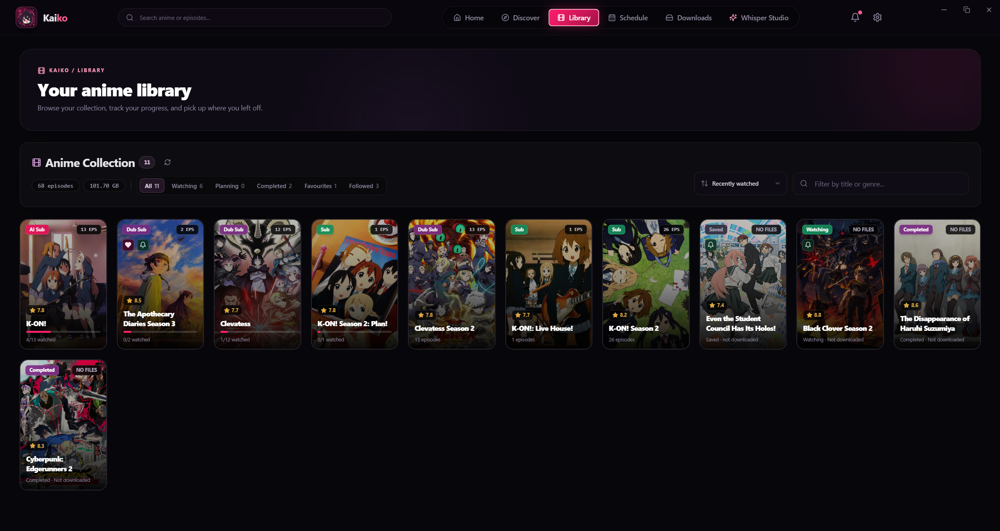
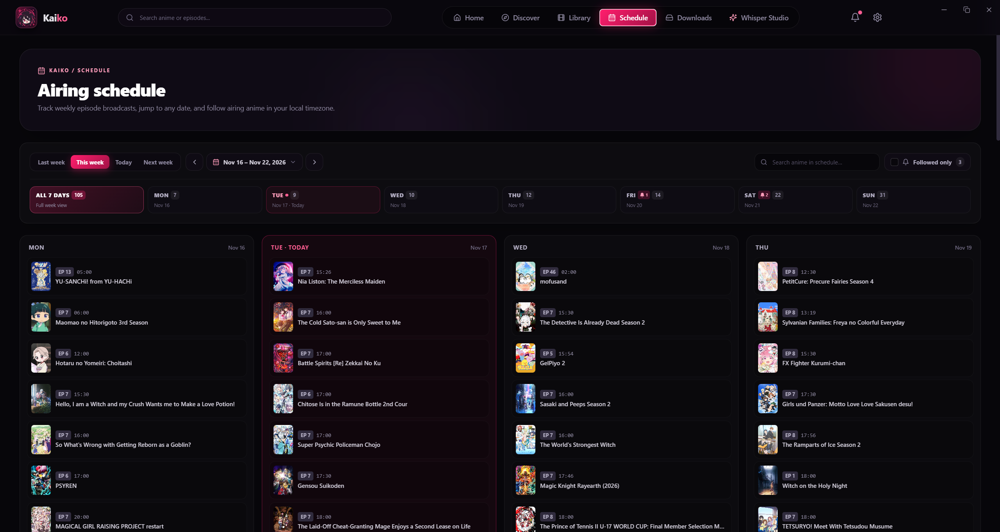
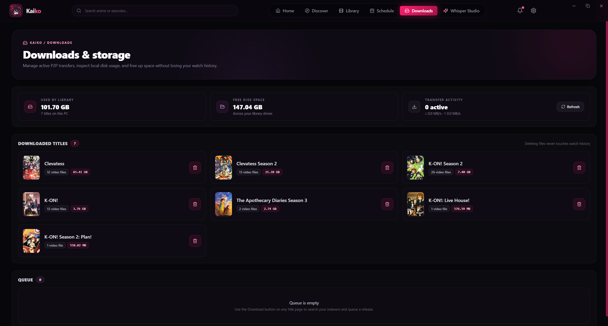
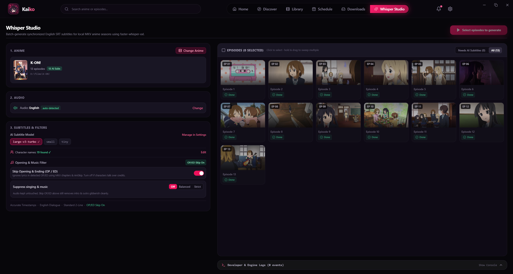
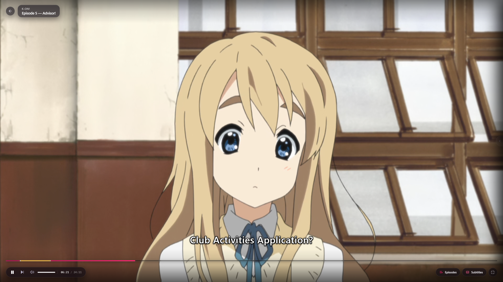

# Kaiko

<p align="center">
  
</p>

<p align="center"><strong>Your anime library, player, and subtitle studio — on your PC.</strong></p>

<p align="center">
  
  
  
  
</p>

Kaiko organizes anime files already on your drives, fetches catalog metadata, and plays episodes locally with built-in FFmpeg support. Optional features include local AI subtitle generation with Faster-Whisper and torrent downloads from RSS/Torznab indexers that you configure yourself.

## Screenshots

### Home — Full-bleed hero, recent episodes, weekly radar & 24-card discovery rails



### Discover — Seasonal lineup, trending/popular feeds & multi-criteria filtering



### Library — Full-width local collection browser with filters & hover pre-warming



### Airing Schedule — 7-day board, week/date navigation, followed indicators & live search



### Downloads & Storage — Library disk usage overview, free drive space & active transfers



### Whisper Studio — Faster-Whisper-XXL subtitle generation & drag range selection



### Video Player — Local HEVC/MKV playback with ASS/SRT/PGS subtitles & quick drawers



## Features

- **Home & catalog navigation:** full-bleed hero resume banner with official series clearlogos, current-episode synopses, recent playback rail, prioritized weekly airing radar with followed-anime badges, and 24-card horizontal genre rails with hover arrows, click-and-drag and touchpad edge wrap-around, and `See all` links into Discover.
- **Smart season-aware artwork:** resolves crisp widescreen (`>= 1200×680`, aspect `>= 1.6`) backdrops identically across Home, Anime Overview, and the translucent Navbar — prioritizing per-season Kitsu art and official TheTVDB Season Backgrounds before falling back to 1080p–4K franchise fanart, cached persistently on disk (`hero_banners_v2.json` & `tvdb_season_cache_v1.json`) for instant restarts.
- **Anime discovery & overview:** full-width layouts across Discover, Library, Schedule, Downloads, and Overview pages; seasonal, trending, popular, and personalized ("For you") feeds; multi-criteria filters, franchise relations, watchlist status/score controls, and episode lists with 16:9 stills.
- **Airing schedule:** switch between a full 7-day board and single-day views, step across weeks or jump via the calendar picker, filter by `Followed only`, and spot followed shows immediately both on Home Weekly Radar and the full Schedule board.
- **Library & playback:** scan multiple local folders with hover metadata pre-warming, track progress and watch status, and play 10-bit HEVC/MKV files with bundled FFmpeg, styled ASS/SRT/Blu-ray PGS subtitles, chapter/intro skip support, and episode/subtitle drawers.
- **Downloads & storage management:** view library disk usage, free drive space, and active transfer speeds; manage P2P episode/season downloads from user-configured RSS/Torznab indexers; delete local series or episodes cleanly while keeping watch history intact.
- **Whisper Studio:** batch-generate synchronized English SRT subtitles locally with Faster-Whisper-XXL, automatic English audio track selection, `pyannote_v3` dialogue presets, OP/ED suppression & 3-mode music filtering (`Off` · `Balanced` · `Strict`), phone-gallery drag range selection, optional character name hints, and 1-click setup.
- **Windows integration:** animated startup splash screen, native `Kaiko.exe` process identity, fast single-pass parallel auto-updates with in-app release notes, and desktop/Start Menu shortcuts.

## Torrent and indexer model

Torrent downloads are an optional feature. The application includes a built-in WebTorrent client; it is **not** a front end for an external qBittorrent or Transmission installation. You provide and configure your own RSS/Torznab indexer endpoints in **Settings -> P2P & Downloads**. No indexer feeds or credentials are shipped in the repository, and the engine will not start until you enable it and accept the in-app notice.

For a magnet link that contains no tracker address, the engine appends a small list of public tracker addresses bundled with the app to improve peer discovery. Magnets that already contain trackers keep their own tracker list. Trackers only help peers find each other; they do not provide search results or host download content. You are responsible for the sources you configure and the material you download or share; check the laws that apply where you live.

## Install the Windows app

Download the `Kaiko-Setup-5.0.0.exe` installer from the project’s GitHub Releases page, run it, and choose an install folder. The installer creates Desktop and Start Menu shortcuts. Updates can also be installed directly from within the app via **Settings -> Updates** or the startup update prompt (with rendered GitHub release notes). During a normal uninstall, Kaiko asks separately whether to remove saved settings, anime lists, and watch history, and whether to clear the contents of configured media-library folders. Both choices default to **No**; deleting library contents requires a second confirmation listing the folders. Clearing a library folder removes every file inside it, not just Kaiko downloads, and leaves the folder itself in place. Silent uninstall and app upgrades preserve personal data.

FFmpeg and a lightweight 7-Zip decompression engine (`7z.exe` + `7z.dll`) are bundled directly into Kaiko for playback, extraction, and automated setup on Windows 10 and Windows 11. The Faster-Whisper-XXL engine can be downloaded and configured in 1 click directly inside Kaiko (or auto-detected from Subtitle Edit / custom paths), along with AI models (`large-v3-turbo`, `medium`, and `small`).

## Build from source

### Requirements

- Windows 10 or 11, 64-bit
- Node.js 18 or later and npm
- Git
- Optional: .NET Framework C# compiler for the standalone shortcut launcher

### Clean install and development

```powershell
git clone https://github.com/zeystom/anime-media-center.git
cd anime-media-center
npm ci
npm run dev
```

### Build and package

```powershell
npm run build
npm start
npm run package
```

`npm run package` creates the Windows NSIS installer under `dist-build/`. `setup.bat` is a convenience script that builds the app and refreshes the local launcher and shortcuts.

### Tests

```powershell
npm test
npm run test:all
```

`npm test` runs the standard regression suite. `test:all` also runs the additional adversarial and interaction checks.

## Network services and local data

Kaiko contacts third-party services for catalog and episode metadata, image assets, intro skip data, and age-rating updates. Your library paths, playback history, settings, and watchlist are stored locally in the app’s user-data folder. Torrent indexer requests use the feeds you configure; there are no bundled feeds or indexer credentials. Whisper transcription runs locally with Faster-Whisper-XXL.

The bundled age-rating index is derived from the [anime-mapper project](https://github.com/subhajeetch-fl/anime-mapper). Source and refresh details are in [`src/data/AGE-RATINGS-SOURCE.md`](src/data/AGE-RATINGS-SOURCE.md). To refresh the bundled copy during development, run `npm run update:age-ratings`.

## License

Kaiko is released under the [MIT License](LICENSE). Third-party services, tools, datasets, and dependencies remain subject to their own terms and licenses.
